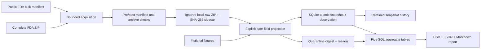

# Drug Shortage Observatory

**A reproducible FDA supply-data analysis with a transactional snapshot warehouse.**

[](https://github.com/LuciferDataEngineer/drug-shortage-observatory/actions/workflows/check.yml)

Analyze which published presentations have a current shortage status, how reported availability differs from that status, and which source-quality issues affect the answer. Preserve the exact downloaded export locally, make repeat loads safe, and compare subsequent observations without inventing clinical events.

**Published evidence:** one complete FDA export dated **18 November 2026**, acquired **19 November 2026**. All sample metrics are observed source-record counts; the offline demonstration uses explicitly fictional data. No Azure deployment, paid service, API key, or hosted schedule is required. FDA advises against using openFDA for medical-care decisions.

**Validated locally:** 40 offline tests passed; all 50 aggregate rows across five SQL outputs matched independent Python calculations.

[Observed report](examples/observed/report.md) · [Validation evidence](docs/VALIDATION.md) · [Source contract and reuse](docs/SOURCE.md) · [SQL](sql)

## Business problem and current relevance

An analyst investigating medicine supply needs defensible counts and traceable changes. A naive `COUNT(*)` can confuse company presentations with unique medicines; filtering `availability = 'Unavailable'` misses current shortage listings that have another availability label. Mutable download URLs and upstream corrections also make yesterday's analysis difficult to reconstruct.

The FDA publishes a manufacturer-informed shortage dataset with daily updates. On 10 November 2026, the DEA issued a production-quota adjustment that used FDA shortage information alongside other supply evidence. This project turns that current operational topic into an auditable analytical workflow. It does not estimate the notice's effect or recommend medicines. [FDA overview](https://open.fda.gov/apis/drug/drugshortages/), [DEA primary notice](https://www.govinfo.gov/content/pkg/FR-2026-11-10/pdf/2026-22842.pdf).

## What the observed export shows

| Source status | Listing rows | Distinct generic labels | Distinct company labels |
|---|---:|---:|---:|
| Current | 1,116 | 69 | 89 |
| Resolved | 59 | 6 | 17 |
| To Be Discontinued | 409 | 158 | 55 |

Of the 1,116 Current rows, **677 report Available**, 284 Unavailable, 154 Limited Availability, and one carries the source spelling `Unvailable`. These are different dimensions: presentation availability and shortage status cannot be treated as interchangeable. Missing availability in the other 468 rows is retained as missing.

The export also contains **one exact duplicate extra row**, **17 repeated natural-key groups**, and **seven generic labels appearing in multiple statuses**. All source rows are preserved; there is no undocumented deduplication. Generic-label counts therefore cannot be summed across statuses. The largest Current category by listing rows is Anesthesia (359 rows, 10 generic labels); category memberships overlap and these counts do not measure patient impact.

These observations are reproducible from the [aggregate CSVs and JSON](examples/observed). This first release has **one observed time point**. Changes in the fictional demonstration are not real shortage trends.

## Architecture



### Stack and rationale

| Component | Choice | Why |
|---|---|---|
| Runtime and acquisition | Python 3.12+ standard library | HTTP, ZIP, checksums and CLI without dependency or credential setup |
| Warehouse | SQLite with WAL, foreign keys and explicit transactions | This complete 1,584-row export fits on a laptop; atomic retryable loads and concurrent readers are useful here |
| Analytical layer | Five inspectable SQL queries | Named denominators, category bridge joins and repeatable aggregates |
| Outputs | CSV, JSON, Markdown | Review in GitHub or load into another analysis tool; no frontend or backend hosting required |
| Validation | `unittest` + independent Python aggregate oracle | Deterministic failure cases plus numerical reconciliation against real source rows |
| CI | GitHub Actions on push/PR, Python 3.12 and 3.14 | Credential-free offline checks; no scheduled network extraction |

macOS or Linux is supported; Windows users need WSL. Atomic report publication uses POSIX advisory locking. Python's bundled SQLite must support window functions (SQLite 3.25+). There are no pip dependencies, subscription requirements, or cloud resources.

## Quick start: fully offline

```sh
git clone https://github.com/LuciferDataEngineer/drug-shortage-observatory.git
cd drug-shortage-observatory
python3 --version
python3 -W error::ResourceWarning -m unittest discover -s tests -v
python3 demo.py --work-dir data/demo
```

Open `data/demo/after/report.md` and `data/demo/comparison.json`. The two **fictional** snapshots produce:

- Before: 6 raw rows, 5 accepted, 1 quarantined.
- After: 5 raw rows, 5 accepted, 0 quarantined.
- Projected multiset comparison: 2 added, 2 removed, 3 unchanged.
- Exact replay leaves snapshot, listing, category and quarantine counts unchanged.

The input lives in [fixtures/synthetic-snapshots.json](fixtures/synthetic-snapshots.json). Names, IDs, categories and changes are invented for teaching. The demo refuses an existing work directory; use `data/demo-2` for another run.

## Run a live source acquisition

Each acquisition makes three credential-free public GET requests: manifest, complete archive, manifest again. It downloads a fresh archive even when the manifest appears unchanged, so same-day byte corrections can be retained. Do not run a tight polling loop.

```sh
# Prints the absolute acquisition-sidecar path; raw data remains under ignored data/.
manifest_path="$(python3 monitor.py fetch --data-dir data)"
python3 monitor.py ingest "$manifest_path" --db data/shortages.sqlite
python3 monitor.py analyze --db data/shortages.sqlite --output data/report-1

# Replay the same verified acquisition. No network calls and no duplicate facts.
python3 monitor.py ingest "$manifest_path" --db data/shortages.sqlite
```

For a later observation, fetch again, ingest its sidecar, and choose a **new** report output directory. Existing reports are preserved. To compare any two loaded snapshots, copy their full IDs from ingest output:

```sh
python3 monitor.py compare BEFORE_SNAPSHOT_ID AFTER_SNAPSHOT_ID --db data/shortages.sqlite
```

Compare uses accepted projected-row **multisets**. A changed availability/date/category field counts as one removal and one addition. Missing source rows mean “no longer observed in this export”; they do not establish a resolved shortage. Quarantined counts should be inspected before interpreting a comparison.

For a bounded live smoke test with numerical reconciliation and database-reopen replay:

```sh
python3 validate_live.py --data-dir data --output data/live-check-1
# To repeat that validation offline, use the saved acquisition path:
python3 validate_live.py --manifest "$manifest_path" --data-dir data --output data/replay-check-1
```

`validate_live.py` uses a temporary test database; it does not mutate your ongoing warehouse. It requires every live row to pass projection and all five SQL tables to equal independently computed Python aggregates. A new source schema or malformed row fails validation for review. Published examples will not necessarily match tomorrow's mutable FDA export.

## Schema and data dictionary

Full DDL: [sql/schema.sql](sql/schema.sql). Dates normalize to ISO calendar dates; no timezone is invented for FDA date-only fields. Acquisition timestamps are timezone-aware UTC. Whitespace-only optional fields become SQL NULL; other labels are preserved exactly.

| Table/view | Grain and key | Meaning |
|---|---|---|
| `snapshots` | `snapshot_id` | Export date plus sorted complete raw-row hashes, retaining duplicate multiplicity; raw/accepted/quarantined conservation counts |
| `observations` | `observation_id` | One acquisition identity: snapshot, source URL, UTC access, byte hash/length and local raw path |
| `observation_rows` | observation + 1-based ordinal | Every acquired raw-row hash, including duplicates and rejected rows; preserves reorder provenance |
| `listings` | snapshot + 1-based ordinal | One accepted source row from the first acquisition of snapshot content |
| `categories` | snapshot + ordinal + category | Unique therapeutic-category membership per row; joins cannot amplify repeated array values |
| `quarantine` | snapshot + ordinal | Rejected row digest and controlled validation reason; original content stays in local raw archive |
| `current_snapshot` | one row | Latest export date; newest normalized acquisition timestamp breaks same-date ties, then deterministic hashes |
| `current_listings` | current snapshot + ordinal | Analytical projection of that complete snapshot |

`listings` includes `generic_name`, `company_name`, `presentation`, `package_ndc`, `dosage_form`, `status`, `availability`, `shortage_reason`, `initial_posting_date`, `update_date`, and `discontinued_date`. NDC stays text. Generic label and supported status are required. Text/date/category type violations are quarantined. Unknown availability text is retained and counted, not silently mapped.

`natural_key` hashes `(generic_name, company_name, presentation, package_ndc)` for collision diagnostics, **not** as a unique constraint. `raw_row_sha256` fingerprints the complete input record; `projected_sha256` fingerprints the normalized allowlist plus categories. Snapshot changes caused only by excluded raw fields can therefore coexist with zero projected changes.

Indexes cover snapshot date, observation chronology, status, generic label, natural key, projected hash and category membership. Contact details, related free text, links and the optional `openfda` object are excluded from SQL and published outputs. Raw ZIPs and acquisition sidecars remain local and ignored by Git.

## Metric definitions

| Query | Definition and interpretation |
|---|---|
| `status_summary.sql` | Count accepted rows and distinct exact generic/company labels within each source status. Distinct labels are not validated unique ingredients or legal entities. |
| `availability.sql` | Status × exact availability, with an explicit reported flag. NULL displays as `Not reported` and remains distinct from a literal source string of the same spelling. |
| `recency.sql` | Export date minus row `update_date`, bucketed 0–7, 8–30, 31–90, 91+ days, missing or after export. Measures metadata age, not shortage duration. |
| `categories.sql` | Current listing rows and distinct generic labels per unique therapeutic-category membership. Categories overlap; do not add their totals. |
| `quality.sql` | Conservation, repeated natural keys, extra exact/projected duplicates, multi-status generic labels, unknown availability and selected missing fields. Duplicate extras = group size minus one. |

No denominator is national medicine consumption, supplier capacity, patient exposure, market share or prevalence. There is no causal model, alert threshold or clinical risk score.

## Reliability, recovery and operating limits

- **Atomic load:** `BEGIN IMMEDIATE` commits facts, categories, rejects, observation mapping and conservation checks together. Constraint/storage errors roll back the acquisition. SQLite serializes writers; the bounded busy timeout is 30 seconds.
- **Idempotency:** replaying the same acquisition cannot add facts or observations. A genuinely new acquisition can add provenance for identical content. Sorted full-row fingerprints make row reordering independent of snapshot identity; per-observation ordinal mappings remain available.
- **Current/history:** older exports can be backfilled without replacing the latest export. Same-day corrections remain separate content snapshots. The warehouse retains each observed version; this is snapshot observation history, not CDC or FDA event history.
- **Read consistency:** all five report queries execute in one reader transaction. New aggregate directories publish atomically and concurrent cooperating writers serialize. Validation evidence is written after the aggregate directory; a failed evidence write must be rerun to a fresh output directory.
- **Failure recovery:** rerun ingest from a verified sidecar after a failed transaction. For damaged raw bytes, preserve them for investigation and reacquire into a new `--data-dir`. Never overwrite a corrupt historical cache and pretend it is the same observation. Network failure or manifest drift requires a later complete retry.
- **Backup:** retain the local raw directory and acquisition sidecars together. With the CLI stopped and connections closed, copy the entire data directory to a protected local backup. To rebuild, ingest sidecars in any order into a new SQLite file. For live SQLite backups use its backup API, not an arbitrary copy of just the `.sqlite` file while WAL writers are active.
- **Bounded source:** 4 MiB per HTTP payload, 16 MiB expanded JSON, 50,000 records, one ZIP member and one complete partition. A 60-second acquisition deadline is checked between reads; an active socket read can extend to its 15-second timeout. Growth/partition changes fail closed for review.
- **Scale and gaps:** one observed real export; history behavior is tested with synthetic changes. No clinical validation, distributed deployment, production SLA, retention scheduler or large-workload benchmark was executed. Source reporting may lag real conditions; revisions with unchanged manifest metadata cannot be proven transactionally consistent upstream.

Cleanup: stop local processes and remove only the chosen generated `data/` work directory when its history is no longer needed. There are no cloud resources to tear down. Future work, **not implemented**, could add observed longitudinal exports, an explicitly approved scheduler and a dashboard with source freshness labels.

## Validation and repository map

[docs/VALIDATION.md](docs/VALIDATION.md) records exact commands, observed results and limitations. CI runs offline tests only; it does not republish metrics or contact a paid provider. Original code is under [MIT](LICENSE). FDA data reuse is separately documented under [CC0/public-domain terms](docs/SOURCE.md).

- `source.py`: bounded bulk adapter and verified replay.
- `warehouse.py`, `sql/schema.sql`: transactions, identities, retained history and safe projection.
- `reports.py`, `sql/*.sql`: reproducible analytical outputs.
- `monitor.py`, `demo.py`, `validate_live.py`: user commands and end-to-end evidence.
- `tests/`, `fixtures/`: offline fault/concurrency and synthetic scenarios.
- `examples/observed/`: reviewed aggregate-only output from the observed export.

## Interview talking points

1. Why NDC and a guessed natural key are insufficient for unique source records; how duplicate preservation protects denominators.
2. Why mutable URLs and unchanged manifests still need fresh bytes, content hashes and separate acquisition identities.
3. Why raw-content identity differs from analytical projection identity, and how same-day corrections are retained.
4. How transactions, foreign keys, row conservation and reopening/replay tests establish one-effect behavior under retries.
5. How Current status can coexist with Available presentations, and why update recency cannot measure shortage duration.
6. Why a small transactional database and explicit SQL fit this problem; what evidence would justify moving to a larger platform.
